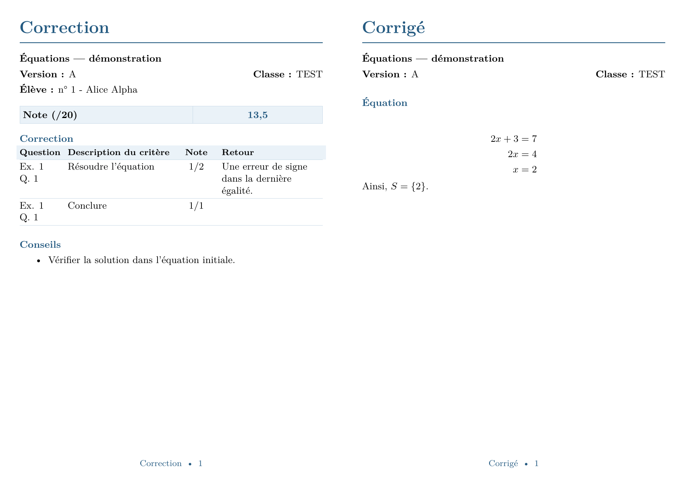

# Interface graphique locale

Depuis la racine du dépôt, avec Python 3.11 ou plus récent :

```sh
python -m pip install ".[gui]"
python -m moteur gui
```

Sous Windows, double-cliquer sur `Lancer-SmartCorrection.cmd`. Ce lanceur utilise `py -3`
ou `python`, installe la dépendance Python de l’interface si elle manque, puis ouvre le navigateur.
Garder la fenêtre de lancement ouverte. Ctrl+C arrête le serveur ; les données restent enregistrées.

L’application ouvre `http://127.0.0.1:8765`. Elle fonctionne sans serveur distant ni clé API.
Les échanges avec l’IA se font par copier-coller et pièces jointes dans une conversation
ouverte par l’enseignant. Ajouter un PDF dans SmartCorrection ne le transmet pas à l’IA.

LaTeX reste nécessaire pour les PDF : une distribution TeX Live ou MiKTeX avec `pdflatex`,
AMS, Geometry, Longtable et Latin Modern. Babel français est recommandé.
`pypdf` compte les pages des sources et assemble les PDF produits par LaTeX ; il ne compose
pas les formules. Sans LaTeX, les imports et les exports de sources `.tex` restent utilisables.

Les fiches sont en **A5 paysage**, divisées en deux zones **A6 portrait**. À gauche figurent
le sujet, la version, la classe et l'élève, puis la note (une ligne, deux colonnes), le tableau
**Question / Description du critère / Note / Retour** et les conseils. À droite figure le corrigé
intégral. Les titres sont bleus et les en-têtes de tableaux bleu clair. Un contenu long continue
du même côté sur les feuilles suivantes. Imprimer à taille réelle, sans agrandissement.
Les noms restent locaux : les afficher sur les fiches ne les ajoute pas aux consignes pour l’IA.

Exemple fictif du rendu (aucune donnée d'élève réelle) :



L’aperçu PDF intégré autorise uniquement une page de la même origine locale à l’afficher.
Les pages de l’application restent interdites d’intégration ; les origines externes restent
bloquées. Si le lecteur PDF du navigateur est désactivé, utiliser « Ouvrir dans un onglet ».

Options :

```sh
smartcorrection-gui --db db/mon-travail.sqlite --data-dir private/mon-travail --port 8766 --no-browser
```

## Les deux boutons de l’accueil

**Ajouter une classe** importe un CSV `nom,prenom`. **Vérifier les élèves** compare les noms à
l’ensemble de la base : accents, casse, tirets, noms/prénoms composés et ressemblances orthographiques.
Chaque proposition montre l’ID permanent, le nom complet et les classes déjà connues. Aucun
rapprochement approximatif ou entre classes n’est appliqué automatiquement. Choisir l’élève existant,
**Nouvel élève** (homonyme), ou une ligne précédente du CSV (doublon), puis **Confirmer l’import**.
Les correspondances exactes déjà inscrites dans cette même classe sont présélectionnées lorsqu’elles
ne sont pas ambiguës. Les autres élèves de la base restent sélectionnables si la suggestion manque.
L’écran final affiche les IDs attribués. L’ID ne dépend ni de la classe ni de l’ordre du fichier.

Les colonnes de liste `numero` des anciens CSV ne définissent jamais l’ID global. Elles sont conservées
uniquement pour les anciens imports CLI. L’interface et ses groupes utilisent désormais l’ID global.
UTF-8 et Windows-1252 sont acceptés, avec virgule, point-virgule ou tabulation comme séparateur.
Un changement du fichier ou des identités après la vérification impose une nouvelle vérification.

Quand un élève déjà inscrit est rapproché d’un autre ID, l’option indique explicitement **Fusionner
ID … dans ID …**. Cette décision réaffecte ses copies et groupes sans perdre ses notes ; les anciennes
identités sont tracées dans un journal de fusion, les variantes de noms sont conservées. Deux copies
ou deux groupes différents pour la même évaluation empêchent la fusion : rien n’est modifié.

À la première ouverture d’une base antérieure, une sauvegarde `*.avant-identites-*.sqlite` est créée
à côté de la base. La migration conserve tous les IDs, inscriptions, copies et notes. Elle ne fusionne
aucun homonyme d’elle-même. Les anciens numéros de liste restent accessibles pour la compatibilité CLI.

**Corriger un paquet de copies** demande la classe et le titre, puis crée un dossier reprenable.
Les classes, dossiers, réponses en cours, documents générés et consignes survivent au redémarrage.

## Le parcours en sept écrans

| Écran | Action de l’enseignant | Résultat conservé |
|---|---|---|
| Préparer le dossier | Ajouter le paquet PDF, le sujet, les documents facultatifs ; copier la procédure dans l’IA et y joindre les PDF | Documents locaux et consignes utilisées au démarrage |
| Grille | Discuter uniquement les critères et le barème ; coller le bloc JSON ; vérifier et valider | Grille relationnelle validée |
| Corrigé | Envoyer la consigne dédiée ; coller le bloc LaTeX complet pour chaque version ; vérifier et valider | Corrigés par version, consultables et modifiables dans ce menu |
| Repérer les copies | Coller le JSON des pages ; relire et rectifier au besoin identités, pages et versions dans le tableau | Copies logiques, pages physiques du paquet et absences déclarées |
| Tester la correction | Choisir une à cinq copies ; coller leurs corrections ; générer les fiches ; demander des ajustements ; valider l’échantillon | Corrections structurées et PDF d’essai |
| Corriger le reste | Copier la consigne pour toutes les copies restantes ; importer les réponses ; générer le document final | Fiches PDF assemblées, données JSON, notes CSV et sources LaTeX |
| Retour d’expérience | Demander à l’IA de réécrire les consignes ; comparer puis valider les deux textes complets | Nouvelles consignes générales et de classe, avec historique |

La correction de l’échantillon peut être remplacée autant que nécessaire. Le reste n’impose
pas une succession de lots de cinq : si l’IA doit fractionner sa réponse, chaque réponse
peut contenir plusieurs **copies complètes**. L’écran indique les copies encore à traiter.

La notation de cette première interface est **individuelle, sur 20, arrondie au demi-point**.
La note brute vient des `CorrectionItem`, puis Python convertit selon le total de la grille.
Les absences restent `ABS`. Le moteur CLI conserve sa configuration plus large et ses groupes.

## Validation et reprises

Le bouton « Vérifier » exécute toutes les validations dans une transaction annulée, puis présente
le résultat. « Valider et enregistrer » relance ces validations et enregistre la réponse entière.
Un seul item invalide annule toute la réponse, y compris les remplacements déjà commencés.
Les doubles clés JSON, `NaN`, les champs inconnus et les réponses d’une ancienne grille sont rejetés.

Une copie non identifiée garde une référence `C001`, etc. Elle peut recevoir une fiche avec cette
référence et la mention « élève non identifié », puis être associée à un élève sans perdre sa
correction. Le CLI `calculate` conserve son exigence d’identification de toutes les copies.
Le numéro d’une copie déjà attribuée et corrigée ne peut pas être changé silencieusement.

Les consignes ne transmettent ni la liste de classe (noms, prénoms, numéros), ni les noms des
fichiers joints. L’IA repère les copies dans le PDF avec des références `C001`, etc. et
renvoie `numero: null`. L’enseignant associe les élèves dans le tableau local de prévisualisation
de l’inventaire, puis vérifie et valide. Les sélections envoyées pour correction ne contiennent
que les références, versions et pages, jamais l’identité locale. Cela n’anonymise pas les PDF :
les noms présents sur les copies jointes restent visibles pour l’IA.

Toutes les pages du paquet doivent être affectées exactement une fois, soit à une copie, soit
à `pages_ignorees` avec un motif. Les pages peuvent être non contiguës. Aucun élève manquant
n’est automatiquement déclaré absent. Le paquet source reste un seul fichier, jamais découpé.
Un dossier accepte un paquet ; pour le remplacer, créer un nouveau dossier.

Une nouvelle grille crée une révision et conserve l’ancien sujet et ses corrections. Les
références et pages des copies sont reprises, mais elles doivent être corrigées avec la nouvelle
grille. Modifier le corrigé de référence signale les corrections concernées « à revoir » et
annule la validation de l’échantillon. L’enseignant peut confirmer une correction existante
après vérification ou importer une correction mise à jour. Les rendus antérieurs sont marqués
« à régénérer ». Une compilation échouée ne publie pas de PDF partiel.

Un message Windows « Accès refusé » concerne les fichiers locaux et ne doit pas être envoyé
à l’IA pour réparation du JSON. Fermer les PDF ouverts puis réessayer ; si l’erreur persiste,
vérifier les droits du dossier de sortie et un éventuel verrouillage par sa synchronisation.
L’export réessaie brièvement les opérations de création, suppression et renommage bloquées.
Si le nettoyage du dossier temporaire échoue aussi, l’erreur initiale reste affichée. La demande
de réparation de format est réservée aux validations de réponses, avec une consigne et une
réponse non vides ; elle n’apparaît plus pour les erreurs de génération ou d’accès aux fichiers.

## Format à demander à l’IA

Le bouton « Je valide l’échantillon » a été supprimé : passer de **Tester la correction** à
**Corriger le reste**, avec « Étape suivante » ou le menu latéral, valide l’échantillon avant
de changer d’écran. Si une copie manque, reste à revoir ou si la sélection n’est pas enregistrée,
le serveur refuse la validation et l’application reste sur l’écran actuel avec l’explication.
Revenir à une étape précédente ne valide rien. Les validations du JSON et des consignes
pédagogiques restent explicites.

La consigne s’affiche automatiquement à l’ouverture de chaque étape. Cliquer sur
« Copier », puis l’envoyer dans la conversation avec l’IA. Coller ensuite
la réponse de l’IA dans la zone de droite, puis cliquer sur « Vérifier » et « Enregistrer et continuer ». Aucun clic de génération
n’est nécessaire. Après un changement de sélection des copies, enregistrer la sélection :
la consigne s’actualise automatiquement. Les documents doivent être joints séparément dans l’IA.

Utiliser en priorité cette consigne : elle contient l’identifiant du dossier,
la révision courante, les items et les références des copies concernés, sans liste nominative. Les formats ci-dessous
sont ceux de l’interface ; les commandes CLI conservent [leurs contrats](correction_format.md).
Le rendu final de l’IA est **un unique bloc de code** `json` (ou `latex` pour le corrigé),
sans texte autour ni autre mise en forme Markdown. Utiliser le bouton « Copier » du bloc.
L’application accepte le contenu brut ainsi qu’un bloc complet avec ses balises ; elle ne
cherche pas de données au milieu d’une discussion. Le JSON reste strict : sans commentaires,
virgule finale, doubles clés ni nombres non finis.

Chaque consigne est composée de deux parties. Le **bloc technique fixe** est généré par
l’application et décrit le format entrée/sortie : enveloppe, champs autorisés, types JSON,
valeurs nulles possibles, absence de calcul de notes et règle « réponse machine uniquement ».
Il ne doit pas être réécrit pendant la discussion. Le bloc pédagogique est variable : il contient
le sujet, la classe, la grille, le corrigé, les copies et les décisions de l’enseignant. L’IA
peut le discuter et le préciser, puis doit produire le format fixé par le premier bloc.

### Grille

L’enveloppe utilise la révision actuelle (0 avant la première validation). L’application l’incrémente
après validation. `validee` n’est pas autorisé : cette décision appartient au bouton enseignant.
Les exercices, questions et items suivent [le format d’évaluation](evaluation_format.md).

```json
{
  "dossier": "IDENTIFIANT_COPIE_DE_LA_CONSIGNE",
  "revision": 0,
  "versions": [{"version": "A"}],
  "grilles": [{
    "nom": "Équations", "version": "A",
    "exercices": [{"numero": "1", "questions": [{"numero": "1", "items": [
      {"code": "E1Q1I1", "description": "Résoudre l’équation", "bareme_max": 2,
       "regle_correction": "Appliquer les exigences discutées avec l’enseignant."},
      {"code": "E1Q1I2", "description": "Conclure", "bareme_max": 1}
    ]}]}]
  }]
}
```

Une grille commune utilise `version: null`. Chaque version doit avoir une grille compatible.
`sujet_latex` est facultatif dans `versions` : joindre le sujet PDF suffit pour ce parcours.
Les codes des items sont uniques dans leur grille, les numéros d’exercice/question sont des
chaînes. Les maxima sont des nombres ; le total d’une grille doit être strictement positif.

### Inventaire des copies

Exemple pour un paquet de trois pages et une grille déjà validée :

```json
{
  "dossier": "IDENTIFIANT_COPIE_DE_LA_CONSIGNE", "revision": 1,
  "copies": [
    {"reference": "C001", "numero": 1, "version": "A", "pages": [1]},
    {"reference": "C002", "numero": null, "version": "A", "pages": [2]}
  ],
  "pages_ignorees": [{"page": 3, "motif": "Page blanche"}],
  "absents": []
}
```

La pagination est physique, à partir de 1 dans le PDF du paquet. `numero` est l’ID global d’un
élève inscrit dans la classe ou `null`. `absents` contient les IDs explicitement déclarés absents.
Les anciennes réponses et brouillons utilisant des numéros de liste doivent être revérifiés et associés
aux IDs affichés dans le tableau local avant de les importer.
Les références `C001` à `C999999` sont stables dans le dossier.

### Corrigé de référence

Coller le **corps LaTeX**, sans enveloppe JSON, préambule, `documentclass` ni `begin/end{document}` :

```latex
\section*{Exercice 1}
\begin{align*}
2x+3 &= 7 \\
2x &= 4 \\
x &= 2
\end{align*}
Ainsi, $S=\{2\}$.
```

Il sera inclus dans les fiches de la version sélectionnée. Le bouton de vérification contrôle
le format général ; la syntaxe LaTeX est vérifiée lors de la compilation des fiches.
Le menu Corrigé dispose d’une grande zone de saisie redimensionnable ; l’aperçu du code n’est
plus plafonné en hauteur. Un corrigé enregistré est rechargé intégralement quand on revient
dans ce menu ; un brouillon en cours reste prioritaire. Aucun nombre de pages ni plafond de
caractères propre au corrigé n’est imposé. La protection générale des requêtes HTTP reste de
160 Mio (un dépassement est refusé, jamais tronqué). L’IA doit développer toutes les questions
et laisser LaTeX répartir le corrigé sur plusieurs pages, sans le condenser pour tenir sur une page.

### Corrections

```json
{
  "dossier": "IDENTIFIANT_COPIE_DE_LA_CONSIGNE", "revision": 1,
  "corrections": [{
    "reference": "C001",
    "items": [
      {"item_code": "E1Q1I1", "points_obtenus": 1, "statut": "partiel",
       "commentaire": "Une erreur de signe dans la dernière égalité.", "annotation": null},
      {"item_code": "E1Q1I2", "points_obtenus": 1, "statut": "acquis"}
    ],
    "annotations": [{"item_code": "E1Q1I1", "page": 1, "texte": "Vérifier le signe."}],
    "conseils": [{"item_code": "E1Q1I1", "texte": "Remplacer x par la solution trouvée pour la vérifier.", "priorite": 1}],
    "commentaire_global": "Méthode comprise ; soigner la vérification."
  }],
  "a_revoir": []
}
```

Tous les items de chaque copie doivent figurer exactement une fois. Les points sont des nombres
finis entre 0 et le maximum. Si le maximum n’est pas attribué, `commentaire` ou `annotation`
est obligatoire et non vide. Les statuts facultatifs sont `acquis`, `partiel`, `non_acquis`,
`non_repondu`. Les annotations sont liées aux items et à une page appartenant à cette copie.
Les coordonnées facultatives suivent [le contrat commun](correction_format.md).

Aucun total, `copie_id`, `grille_id` ou groupe n’est attendu de l’IA ici. L’application résout
les références puis appelle l’importeur commun. Pour corriger une réponse antérieure, fournir
de nouveau tous les items de la copie concernée. Les réponses acceptées restent dans l’historique
d’échanges SQL ; les tables de correction contiennent la dernière version validée.

Pour une écriture illisible, omettre cette copie de `corrections` et fournir
`"a_revoir": [{"reference": "C002", "motif": "Dernière ligne illisible"}]`.
Il ne faut ni inventer un score, ni traiter une copie incomplète comme un zéro.

### Consignes pour la prochaine fois

Après le document final (ou l’export final des sources), demander deux **textes complets de
remplacement**, basés sur les décisions réelles de la discussion. Recopier les identifiants
des consignes actives depuis le message généré ; `null` signifie qu’aucune version n’existe encore.

```json
{
  "dossier": "IDENTIFIANT_COPIE_DE_LA_CONSIGNE", "revision": 1,
  "base_generale": null, "base_classe": null,
  "generales": "Ne pas pénaliser deux fois une même erreur propagée, sauf règle explicite de la grille.",
  "classe": "Exiger une conclusion rédigée après la résolution."
}
```

Ces règles sont des **exemples**, pas des choix appliqués par défaut. L’enseignant compare la
proposition avec les textes actifs avant de remplacer. Les anciennes versions restent conservées.
Si une autre évaluation a déjà mis à jour les consignes, une proposition fondée sur l’ancienne
version est rejetée. Un dossier en cours garde les consignes de son démarrage ; seuls les nouveaux
dossiers prennent les nouveaux textes. Ne conserver ni noms, ni notes individuelles, ni règles
propres à un seul exercice dans les consignes durables.

## Données, sauvegarde et limites

Par défaut : base `db/smartcorrection.sqlite`, PDF et rendus sous `private/interface/`.
Sauvegarder **les deux**, application arrêtée. Les chemins de documents sont absolus : conserver
l’emplacement lors d’une restauration. Les données élèves et sorties sont ignorées par Git.

Au premier lancement, les Markdown de classe existants, dont `classes/TMEX.md`, sont importés
une fois dans les consignes SQLite. Ensuite, le parcours graphique lit et remplace ces consignes
dans l’application : il n’utilise plus les `.md` comme mémoire active. Les anciens fichiers et
l’option CLI `--classe-md` restent disponibles pour compatibilité. Les grilles lisibles continuent
d’être exportées en Markdown.

Le serveur écoute uniquement la boucle locale, vérifie l’origine des requêtes et exige un jeton
pour les écritures. Il sert uniquement les fichiers enregistrés sous son répertoire de données.
Le LaTeX doit rester un fragment de confiance ; [les précautions de compilation](../latex/README.md)
ne constituent pas un bac à sable complet.

Les annotations sont listées sur la fiche, pas dessinées sur le scan original. Les documents
joints à ce premier parcours doivent être des PDF. Les variantes de notation et groupes restent
accessibles dans le moteur CLI. Les tests utilisent des évaluations **fictives** : la relecture
d’un paquet réel, du rendu et du parcours Windows reste une étape de validation enseignant.

### Note de groupe Maths expertes

Dans **Repérer les copies**, ouvrir **Note de groupe · Maths expertes** après avoir enregistré la grille.
Le même panneau est accessible dans **Tester la correction** et **Corriger le reste**.
L’option est désactivée par défaut. Cocher **Activer la note de groupe**, coller une ligne d’IDs
par groupe (`2, 31, 3, 22`), puis **Enregistrer les groupes**. Le tableau affiche les identités locales ;
les doublons et numéros inconnus sont refusés sans modifier les groupes enregistrés. Les élèves
sans groupe sont signalés. Les groupes ne sont jamais ajoutés aux consignes IA.

La note individuelle est convertie sur 15 ; la moyenne des **autres membres** est convertie sur 5.
La finale est leur somme sur 20, arrondie au demi-point comme dans le moteur existant. Les absents
sont exclus de la moyenne. Une copie non corrigée, non repérée ou à revoir laisse la part groupe
et la finale en attente. Sans camarade disponible ou sans identité/groupe, elles restent « À traiter ».
Le test sur cinq copies utilise aussi les camarades hors échantillon, sans inventer leurs notes.

Les fiches A5 paysage conservent correction à gauche et corrigé à droite. En mode groupe, le tableau
comporte individuel /15, groupe /5 (détail des camarades en petit) et finale /20. Les exports CSV/JSON
contiennent ces notes ; `etat_groupe` explique les notes vides. Un document final peut contenir des cas
« À traiter » : document produit ne signifie pas que toutes les notes sont calculables.

Changer les groupes ou une correction invalide les anciens PDF. Régénérer les fiches recalcule les
notes depuis SQLite. Changer de grille conserve les groupes ; désactiver l’option conserve leur saisie
et revient à la notation individuelle sur 20.

### Lecture des échanges

Les deux zones restent visibles : **Consigne à copier dans l’IA**, avec **Copier** en dessous, et **Résultat de l’IA**. Après **Vérifier**, **Enregistrer et continuer** enregistre la grille, le corrigé ou l’inventaire et ouvre la suite. Les versions de corrigé manquantes sont proposées successivement.

Pour les corrections, **Enregistrer les corrections** reste sur la page afin de relire les fiches ou d’importer une autre réponse. **Voir les fiches du test** ouvre le PDF ; passer à l’étape suivante valide ensuite l’échantillon. **Créer le PDF final** produit le rendu complet. Les sources LaTeX et les documents précédents sont dans **Plus d’options**.
